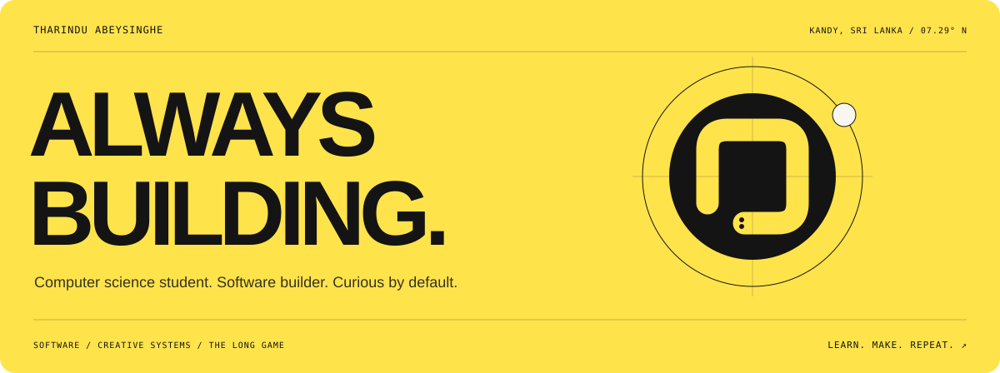
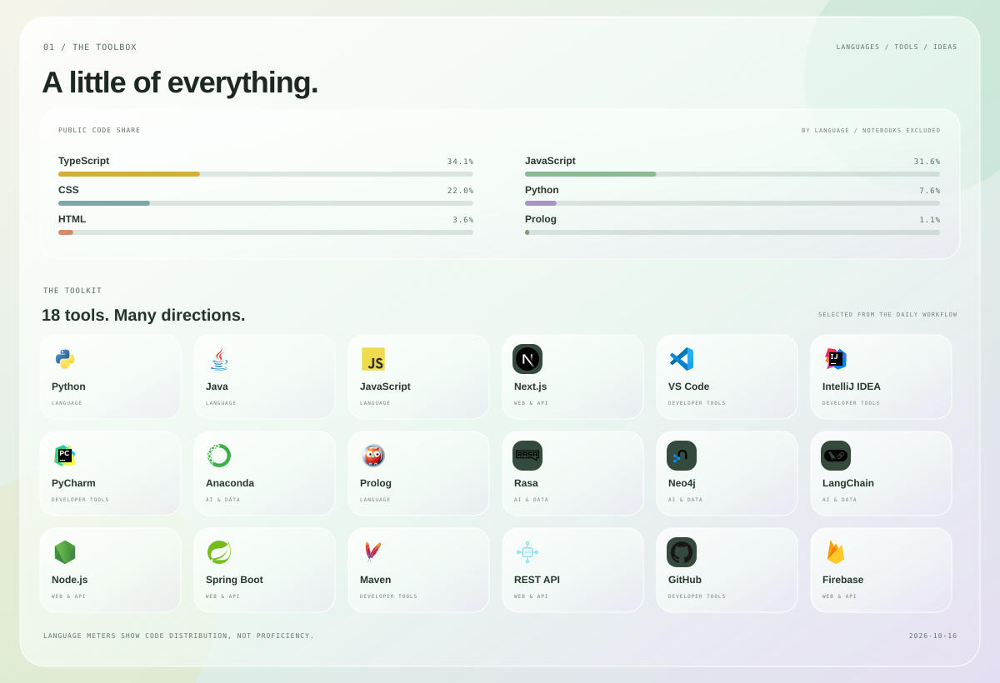
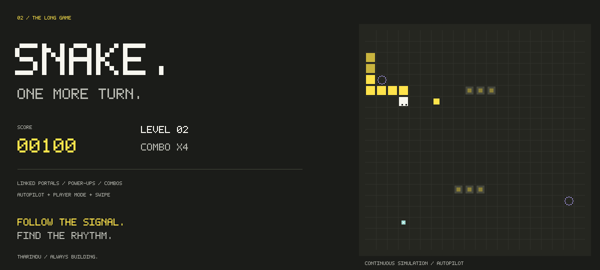
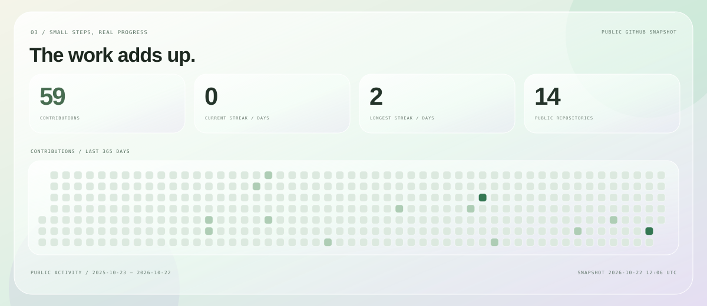

  

  <a href="https://tharindu336.github.io/Tharindu336/"><strong>OPEN THE INTERACTIVE GLASS PORTFOLIO ↗</strong></a>
  &nbsp; · &nbsp;
  <a href="https://www.linkedin.com/in/tharindu-abeysinghe-226a912b3/">LET'S CONNECT ↗</a>

  I'm <strong>Tharindu Abeysinghe</strong>, a computer science student and software builder in Kandy, Sri Lanka.
   
  Curious by default. Always learning by making.

  

  <picture>
    <source media="(prefers-reduced-motion: reduce)" srcset="./profile-snake-still.svg">
    
  </picture>

  

<strong>LEARN. MAKE. REPEAT.</strong>

