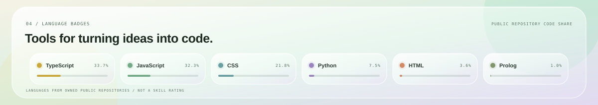

  

  
  &nbsp;
  

  

  I'm <strong>Tharindu Abeysinghe</strong>, a computer science student and software builder in Kandy, Sri Lanka.
   
  Curious by default. Always learning by making.

  

  <picture>
    <source media="(prefers-reduced-motion: reduce)" srcset="./profile-snake-still.svg">
    
  </picture>

  

  

<strong>LEARN. MAKE. REPEAT.</strong>

