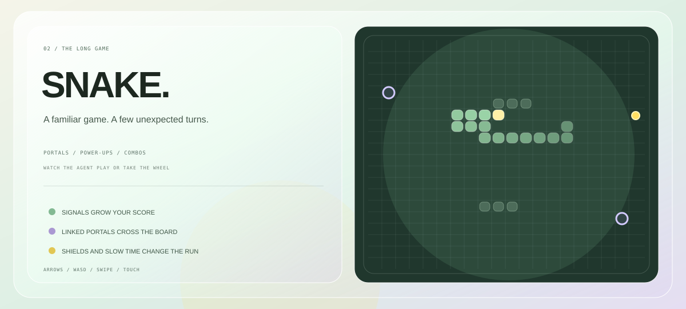

  

  <a href="https://www.linkedin.com/in/tharindu-abeysinghe-226a912b3/"><strong>LET'S CONNECT ↗</strong></a>
  &nbsp; · &nbsp;
  <a href="https://github.com/Tharindu336">EXPLORE MY CODE ↗</a>

  I'm <strong>Tharindu Abeysinghe</strong>, a computer science student and software builder in Kandy, Sri Lanka.
   
  Curious by default. Always learning by making.

  

  

  

<strong>LEARN. MAKE. REPEAT.</strong>

